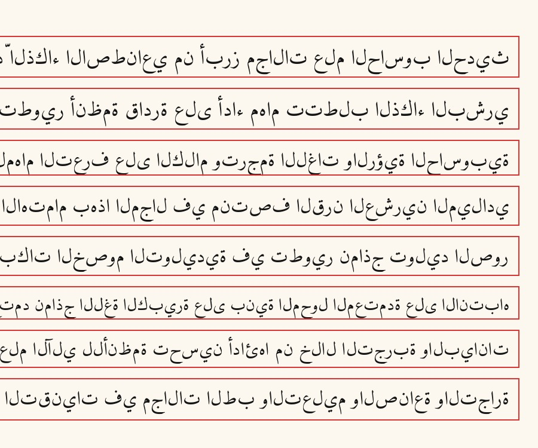

# YOLOv8 Arabic Line Detector

> Find text lines on an Arabic page image. Returns one bounding box per line, sorted top-to-bottom.

**Part of the [Arabic Line OCR project](https://github.com/<YOUR_GITHUB_USERNAME>/arabic-line-ocr).**

---


*Synthetic page with numbered detected boxes.*

---

## What it does

Given a page image, the detector returns one bounding box per text line. It does **not** perform text recognition — for that, see the main OCR repo above.

**Important:** The model has two output classes (`printed_line`, `handwritten_line`), but **the class labels are unreliable on real pages** — nearly everything is predicted "handwritten" regardless of the actual content. Use the bounding boxes only; ignore the class predictions.

---

## Training

- **Architecture:** YOLOv8n (Ultralytics)
- **Classes:** 2 — `printed_line` (0), `handwritten_line` (1)
- **Training pages:** 2,000 synthetic 2500×2500 px pages (train), 200 (val)
- **Total boxes:** ~42,000 per class across train split
- **Image size:** 1280 px (longest side)
- **Epochs:** 100 (early stopping patience=10)
- **Other settings:** fliplr=0.0 (Arabic text must not be mirrored)

### Validation metrics (from training run)

| Metric | Value |
|---|---|
| Precision | 0.998 |
| Recall | 0.999 |
| mAP50 | 0.995 |
| mAP50-95 | 0.972 |

These numbers are on the synthetic val set (same generator as training) and are therefore optimistic. Real-page evaluation was informal — one printed textbook page and one Quran photo, both hand-checked.

### Synthetic training data

Pages are generated by [`scripts/make_synthetic_pages.py`](scripts/make_synthetic_pages.py):
- **Printed lines:** Arabic Wikipedia sentences rendered with Amiri font at random sizes (28–40 pt).
- **Handwritten lines:** real KHATT dataset images scaled to a random height (60–110 px).
- Lines are placed at a random horizontal offset and spacing on a 2500×2500 white canvas with a slight yellowish tint.
- Labels are in YOLO format (normalized centre + width + height).

The KHATT dataset must be downloaded separately (see [KHATT terms](http://khatt.ideas2serve.net/)).

---

## Usage

### Install

```bash
git clone https://github.com/<YOUR_GITHUB_USERNAME>/yolo-line-detector.git
cd yolo-line-detector
pip install -r requirements.txt
```

### Python

```python
from src.detect import detect_lines

boxes = detect_lines("page.jpg")
# -> [(x0, y0, x1, y1), ...]  sorted top-to-bottom

for i, (x0, y0, x1, y1) in enumerate(boxes, start=1):
    print(f"Line {i}: ({x0},{y0}) -> ({x1},{y1})")
```

### CLI

```bash
# Print box coordinates
python src/detect.py page.jpg

# Draw numbered boxes and save
python src/detect.py page.jpg --draw --out page_detected.jpg

# Custom weights
python src/detect.py page.jpg --weights /path/to/best.pt
```

Default parameters: `imgsz=1280`, `conf=0.4`, `iou=0.5`.

---

## Known limitations

- **Class labels are unreliable on real pages.** Nearly everything is predicted "handwritten" regardless of content. Use boxes only.
- **Boxes span the full text width** and can overlap vertically. The OCR pipeline trims each box's top to the bottom of the box above (`get_boxes()` in the main repo).
- **Short lines can be missed.** Lines shorter than ~60 px at 1280-px inference may fall below the confidence threshold.
- **Empty regions are sometimes boxed** (e.g., large blank margins or decorative elements).
- **Trained on synthetic pages only.** The model has never seen real handwriting during detector training — it has only seen real handwritten images pasted into synthetic layouts.
- **Poem lines with a wide central gap** are often split into two boxes or missed.
- **Column layouts** are not handled — reading order for multi-column pages is wrong.
- **Informal real-page testing:** one printed textbook page and one Quran photo.

---

## Future work

- One-class detector (removes the unreliable class-label problem entirely).
- Training pages with varied alignment, poem-style gaps, and short lines.
- Better handling of column layouts.

---

## License

This repo is licensed under **[AGPL-3.0](LICENSE)** because it uses Ultralytics YOLOv8, which is AGPL-3.0. Any code or derivative work that uses this repo must also be released under AGPL-3.0 (or a compatible license) if distributed.

The `best.pt` weights were produced by training on:
- KHATT dataset (terms apply, see [khatt.ideas2serve.net](http://khatt.ideas2serve.net/))
- Synthetic printed lines (Amiri font: SIL OFL 1.1; Arabic Wikipedia text: CC BY-SA 4.0)

---

## Generating training data

```bash
python scripts/make_synthetic_pages.py \
    --khatt-train /path/to/KHATT/Train_deskewed/Train_deskewed \
    --khatt-val   /path/to/KHATT/Validate_deskewed/Validate_deskewed \
    --khatt-csv-train /path/to/KHATT/Train.csv \
    --khatt-csv-val   /path/to/KHATT/Validation.csv \
    --fonts Amiri-Regular.ttf \
    --out ./generated_pages \
    --n-train 2000 --n-val 200
```

Requires: `pillow`, `datasets`, `arabic-reshaper`, `python-bidi`.
